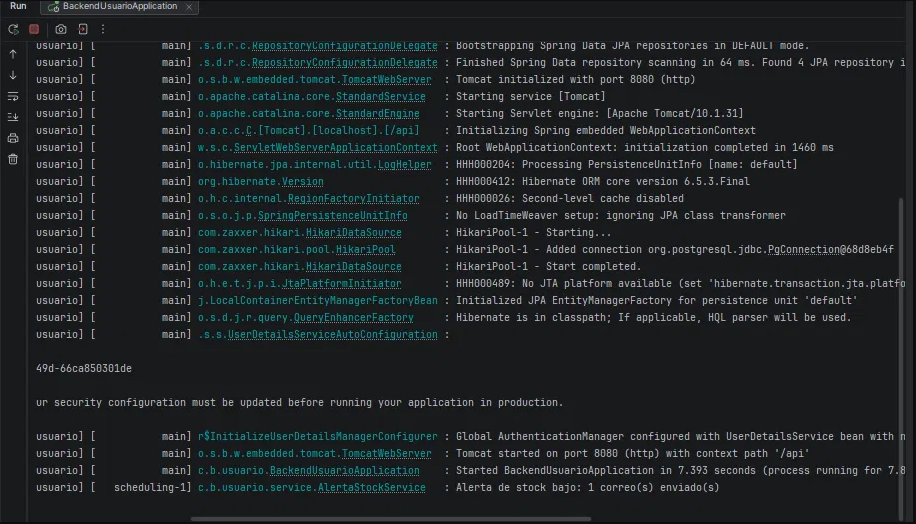

# H55 · Notificación de stock por agotarse

- Historia (Lab06 #91): Como sistema, quiero enviar una notificación al dueño de botica cuando su stock de un producto esté por agotarse, para que lo reabastezca.
- Criterio de aceptación: Cada día, el dueño de una botica aprobada recibe un correo con sus productos activos cuyo stock es menor o igual a su stock mínimo; si no tiene ninguno, no recibe nada (ya implementado en el Sprint 1, H12).
- Responsable: Alexander · Fecha de la prueba: 01/11/2026 · Entorno: API Spring Boot local (`main`, commit `376e746`) contra Supabase, correo por Resend (SMTP `smtp.resend.com:587`) desde `notificaciones@boticompara.nissidev.dev`; el buzón `rosa@boticompara.nissidev.dev` reenvía a la bandeja del equipo

## Pasos

1. Revisar en la BD, con la misma regla del servicio, qué dueños recibirían la alerta (para no enviar correos a dominios ajenos y cuidar el límite de 100 correos al día de Resend).
2. En el `.env` local, activar la alerta y programarla para unos minutos después: `ALERTA_STOCK_HABILITADA=true` y `ALERTA_STOCK_CRON=0 41 12 * * *` (por defecto es todos los días a las 8:00, hora de Lima).
3. Levantar la API y esperar la ejecución de las 12:41.
4. Revisar el log y el correo en la bandeja del equipo.
5. Volver a dejar `ALERTA_STOCK_HABILITADA=false` y quitar `ALERTA_STOCK_CRON`.

## Resultado esperado

Sale un solo correo, al dueño de la única botica aprobada con productos en o por debajo del mínimo, con la lista de esos productos. Las boticas sin productos bajos no reciben nada.

## Resultado obtenido

Revisión previa en la BD:

| Botica | Dueño | Productos con stock ≤ mínimo | ¿Recibe? |
|---|---|---|---|
| Botica Salud Total | rosa@boticompara.nissidev.dev | Loratadina Genérica: stock 3, mínimo 5 | Sí |
| FarmaVida | jorge@boticompara.nissidev.dev | Ninguno | No |
| Botica Vida Sana | (cuenta de prueba) | Ninguno | No |

Log de la API a las 12:41 (hilo `scheduling-1`):

```
c.b.usuario.service.AlertaStockService : Alerta de stock bajo: 1 correo(s) enviado(s)
```



Correo recibido en la bandeja del equipo:

- Asunto: "BotiCompara: 1 producto con stock bajo en Botica Salud Total".
- Cuerpo: "Loratadina Genérica (...): stock 3, mínimo 5".


Después de la prueba se volvió a desactivar la alerta en el `.env` local, para no enviar el aviso diario mientras se desarrolla.

## Estado: ✅ Cumple
