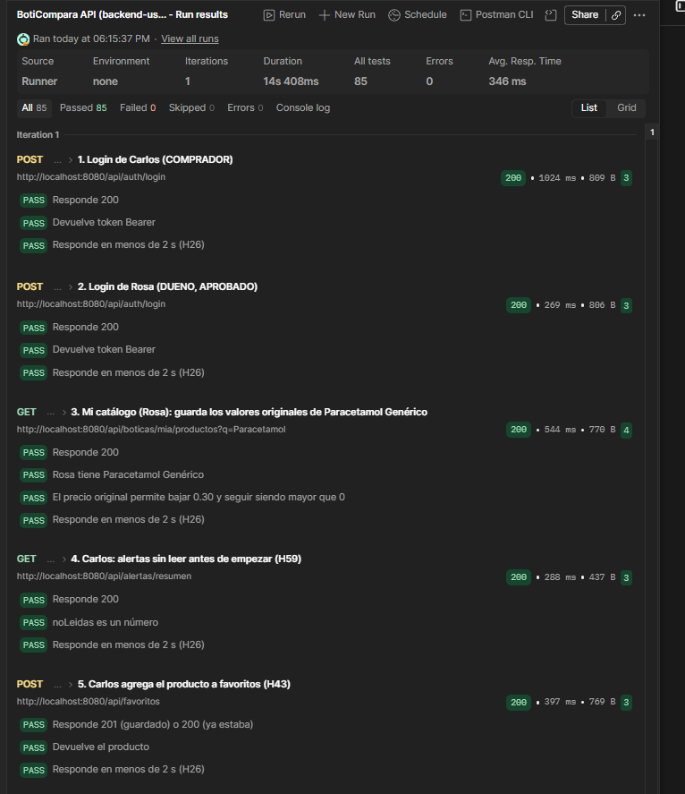

# H59 · Alerta cuando baja el precio de un favorito

- Historia: Como usuario comprador, quiero recibir una alerta cuando baje el precio de un producto que tengo en favoritos, para aprovechar el mejor precio.
- Criterio de aceptación: Al bajar el precio de un producto en `PUT /productos/{id}` o en la carga masiva, cada usuario que lo tiene en favoritos recibe una alerta (si cumple su precio objetivo, ver [H60](H60.md), y tiene las alertas activas, ver [H66](H66.md)). El usuario puede listar sus alertas, ver cuántas tiene sin leer y marcarlas como leídas. Si el precio sube o no cambia, no hay alerta.
- Responsables: Mijael (móvil, pantalla Alertas), Alexander (API) · Fecha de la prueba: 08/11/2026 · Entorno: API Spring Boot local (`main`) contra Supabase, colección de Postman `BotiCompara.postman_collection.json` (carpeta 9) con las sesiones de Carlos (comprador) y Rosa (dueña de Botica Salud Total)

Esta evidencia cubre la parte de la API. La parte del móvil la agrega Mijael.

## Pasos

Carpeta **9. Alertas de precio** de Postman, ejecutada completa con *Run folder*. Rosa baja el precio de su producto Paracetamol Genérico y Carlos lo tiene en favoritos:

1. Carlos anota cuántas alertas sin leer tiene (`GET /alertas/resumen`) y guarda el producto en favoritos.
2. Rosa baja el precio sin llegar al objetivo de Carlos: no debe haber alerta.
3. Rosa baja el precio hasta el objetivo: debe haber una alerta nueva.
4. Carlos lista sus alertas sin leer (`GET /alertas?soloNoLeidas=true`) y marca la alerta como leída (`PUT /alertas/{id}/leida`).
5. Pruebas de error: `GET /alertas` sin token, `soloNoLeidas=quizas`, marcar una alerta que no existe y un id no numérico.
6. Rosa restaura el precio original: una subida de precio no debe crear alerta.

## Resultado esperado

La baja que cumple el objetivo crea exactamente una alerta, con el precio anterior, el precio nuevo y el ahorro. La alerta se puede leer y marcar como leída, y el contador vuelve al número inicial. Una subida de precio o una baja que no llega al objetivo no crea nada.

## Resultado obtenido

| Paso | Respuesta | Resultado |
|---|---|---|
| Baja que no llega al objetivo | `200` | Las alertas sin leer siguen igual |
| Baja hasta el objetivo | `200` | Las alertas sin leer suben en 1 |
| `GET /alertas?soloNoLeidas=true` | `200` | La más reciente es esta baja: precio anterior y nuevo correctos, `ahorro` = 0.10, `leida` = `false`, con nombre, presentación, botica y fecha |
| `PUT /alertas/{id}/leida` (dos veces) | `204` | Marcar otra vez también responde `204` |
| Contador después de marcarla | `200` | Vuelve al número inicial |
| `PUT /alertas/999999999/leida` | `404` | |
| `PUT /alertas/abc/leida` | `400` | |
| `GET /alertas` sin token | `401` | |
| `GET /alertas?soloNoLeidas=quizas` | `400` | |
| Subida de precio (restaurar el original) | `200` | Las alertas sin leer siguen igual |

Resultado del *Run* de Postman (toda la carpeta, incluidos H60 y H66): **85 pruebas pasadas, 0 fallidas, 0 errores**, en 14 s.

Datos de prueba: no se crean productos. El flujo deja una alerta ya leída en el historial de Carlos (no hay endpoint para borrarlas) y el precio de Rosa queda como estaba.

## Estado: ✅ Cumple (API)
