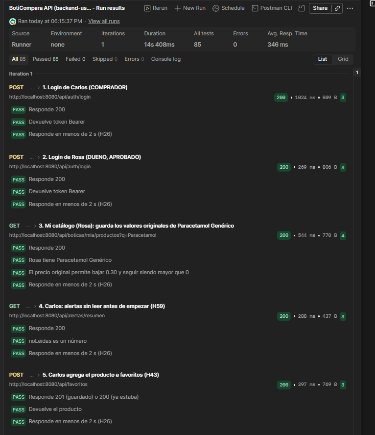

# H60 · Precio objetivo de un favorito

- Historia: Como usuario comprador, quiero poner un precio objetivo a un producto que tengo en favoritos, para que me avisen solo cuando llegue a ese precio.
- Criterio de aceptación: `PUT /favoritos/{productoId}/precio-objetivo` pone, cambia o quita (con `null`) el precio objetivo de un favorito. Debe ser mayor que 0, con máximo 2 decimales y menor que 100000. Con un precio objetivo, la alerta de [H59](H59.md) solo se crea si el precio nuevo es menor o igual que el objetivo y menor que el último precio avisado. Al poner, cambiar o quitar el objetivo se reinicia el último precio avisado.
- Responsables: Mijael (móvil, campo en Favoritos), Alexander (API) · Fecha de la prueba: 08/11/2026 · Entorno: API Spring Boot local (`main`) contra Supabase, colección de Postman `BotiCompara.postman_collection.json` (carpeta 9) con las sesiones de Carlos (comprador) y Rosa (dueña de Botica Salud Total)

Esta evidencia cubre la parte de la API. La parte del móvil la agrega Mijael.

## Pasos

Carpeta **9. Alertas de precio** de Postman. Carlos tiene en favoritos Paracetamol Genérico, de Rosa:

1. Carlos pone como precio objetivo el precio original menos 0.20.
2. Casos de error: cuerpo `{}`, precio objetivo `0`, un producto que no está en sus favoritos y una llamada sin token.
3. Rosa baja el precio en 0.10 (sobre el objetivo) y luego en 0.20 (llega al objetivo).
4. Al final Carlos quita el precio objetivo con `null`.

## Resultado esperado

El precio objetivo se guarda y se devuelve en el favorito. La baja que no llega al objetivo no crea alerta; la que llega al objetivo sí. Los datos inválidos responden con el error que corresponde.

## Resultado obtenido

| Paso | Respuesta | Resultado |
|---|---|---|
| Poner el precio objetivo (original − 0.20) | `200` | El favorito devuelve `precioObjetivo` con ese valor |
| Cuerpo `{}` | `400` | Falta el campo `precioObjetivo` |
| `precioObjetivo: 0` | `400` | |
| Producto que no está en sus favoritos | `404` | |
| Sin token | `401` | |
| Rosa baja el precio en 0.10 (sobre el objetivo) | `200` | No se crea alerta |
| Rosa baja el precio en 0.20 (llega al objetivo) | `200` | Se crea 1 alerta |
| Quitar con `{ "precioObjetivo": null }` | `200` | El favorito queda con `precioObjetivo` en `null` |

Resultado del *Run* de Postman (toda la carpeta): **85 pruebas pasadas, 0 fallidas, 0 errores**, en 14 s. Ver la captura en [H59](H59.md).

## Estado: ✅ Cumple (API)
