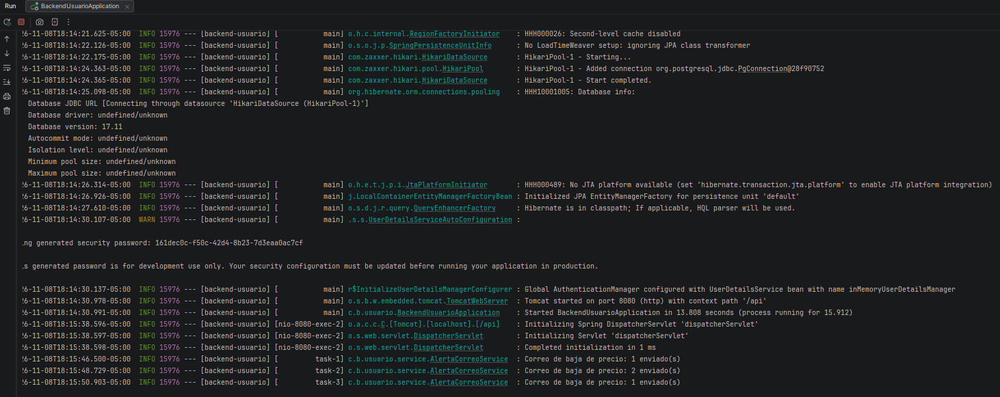

# H61 · Correo cuando baja el precio de un favorito

- Historia: Como usuario comprador, quiero recibir un correo cuando baje el precio de un producto que tengo en favoritos, para enterarme aunque no abra la app.
- Criterio de aceptación: Cuando baja el precio de un favorito y se crea la alerta de [H59](H59.md), se envía un correo con el producto, la botica y el precio anterior y nuevo. Sale después de guardar el cambio y en segundo plano, sin hacer más lenta la respuesta. En `PUT /productos/{id}` es un correo por alerta; en la carga masiva, un solo correo por usuario con todas sus bajas. Si el correo falla, la alerta queda guardada. No se envía a quien tiene las alertas desactivadas ([H66](H66.md)) ni cuando el precio no llega al objetivo ([H60](H60.md)).
- Responsable: Alexander · Fecha de la prueba: 06/11/2026 y 08/11/2026 · Entorno: API Spring Boot local contra Supabase; correo por Resend (SMTP `smtp.resend.com:587`) desde `notificaciones@boticompara.nissidev.dev`. Prueba 1: rama `feature/backend-correo-alertas`, con `MAIL_HOST` vacío. Prueba 2: `main`, con `MAIL_HOST` configurado.

## Prueba 1 · Sin enviar correos reales (06/11/2026)

Con `MAIL_HOST` vacío, el servicio no envía nada y deja en el log el asunto con el que habría salido. Así se prueba sin gastar el límite de 100 correos al día de Resend. Script local de PowerShell con un comprador `ZZ` (que se borra al final) y dos productos `ZZ` en la botica de Rosa.

### Pasos

1. `PUT /productos/{id}` baja el precio de 10.00 a 9.00.
2. `PUT /productos/{id}` sube el precio a 9.50.
3. Carga masiva con dos productos favoritos que bajan de precio.
4. Con el comprador con las alertas desactivadas (H66), baja el precio a 7.50.

### Resultado obtenido

| Comprobación | Resultado |
|---|---|
| Baja 10.00 → 9.00: la alerta queda guardada aunque el correo no se envíe | OK |
| Correo de la baja: asunto "… bajó a S/ 9.00 en Botica Salud Total" | OK |
| Sube a 9.50: sin alerta nueva | OK |
| Sube a 9.50: no sale ningún correo | OK |
| Carga masiva con 2 bajas: 2 alertas nuevas | OK |
| **Un solo** correo con las 2 bajas: asunto "Bajaron de precio 2 productos de tus favoritos" | OK |
| Con las alertas desactivadas: sin alerta nueva | OK |
| Con las alertas desactivadas: no sale ningún correo | OK |

Resultado del script: **8 OK, 0 fallas**. Log de la API (los correos salen en hilos propios, `task-1` y `task-2`, fuera del hilo de la petición):

```
c.b.usuario.service.CorreoService        : Correo no configurado (MAIL_HOST vacio): no se envio "ZZ Prueba H61 bajó a S/ 9.00 en Botica Salud Total"
c.b.usuario.service.AlertaCorreoService  : Correo de baja de precio: 0 enviado(s)
c.b.usuario.service.CorreoService        : Correo no configurado (MAIL_HOST vacio): no se envio "Bajaron de precio 2 productos de tus favoritos"
c.b.usuario.service.AlertaCorreoService  : Correo de baja de precio: 0 enviado(s)
```

Los datos `ZZ` se borraron al terminar.

## Prueba 2 · Con envío real por Resend (08/11/2026)

Se corrió la carpeta 9 de Postman (ver [H59](H59.md)) con `MAIL_HOST` configurado. En ese flujo Rosa cambia tres veces el precio de Paracetamol Genérico, que Carlos tiene en favoritos con un precio objetivo.

Log de la API (`AlertaCorreoService` cuenta los correos que el servidor SMTP aceptó):



| Hora | Cambio de precio (paso de Postman) | Correos enviados |
|---|---|---|
| 18:15:46 | Rosa baja el precio sin llegar al objetivo de Carlos (paso 6) | 1 |
| 18:15:48 | Rosa baja el precio hasta el objetivo de Carlos (paso 8) | 2 |
| 18:15:50 | Rosa baja el precio con las alertas de Carlos desactivadas (paso 13) | 1 |

Los conteos coinciden con las pruebas de Postman, que comprueban que Carlos solo recibe alerta en el paso 8: no la recibe en el paso 6 (no llegó a su objetivo) ni en el 13 (las tiene desactivadas). Los envíos restantes son de otros usuarios que tienen el mismo producto en favoritos sin precio objetivo. Cada correo salió en un hilo propio (`task-1`, `task-2`, `task-3`).

**Pendiente:** la captura del correo que recibió Carlos (18:15, asunto "Paracetamol Genérico bajó a S/ … en Botica Salud Total"). La bandeja del equipo la tiene Guillermo, quien la agregará como `img/H61-correo.png` y la enlazará aquí.

## Estado: ✅ Cumple (falta la captura del correo, que agrega Guillermo)
