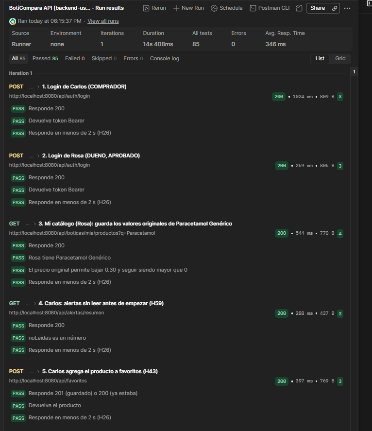

# H66 · Activar o desactivar las alertas de precio

- Historia: Como usuario, quiero activar o desactivar las alertas de precio, para decidir si quiero recibirlas.
- Criterio de aceptación: `PUT /usuarios/me/notificaciones` con `{ "notificacionesPrecio": true | false }` cambia la preferencia y devuelve el perfil con `notificacionesPrecio` (por defecto `true`). Un usuario con las alertas desactivadas no recibe alertas de precio ni correos, aunque baje el precio de sus favoritos. Si falta el campo, responde `400`.
- Responsables: Mijael (móvil, interruptor en el perfil), Alexander (API) · Fecha de la prueba: 08/11/2026 · Entorno: API Spring Boot local (`main`) contra Supabase, colección de Postman `BotiCompara.postman_collection.json` (carpeta 9) con las sesiones de Carlos (comprador) y Rosa (dueña de Botica Salud Total)

Esta evidencia cubre la parte de la API. La parte del móvil la agrega Mijael.

## Pasos

Carpeta **9. Alertas de precio** de Postman. Carlos tiene en favoritos Paracetamol Genérico, de Rosa:

1. Carlos desactiva las alertas de precio.
2. Caso de error: cuerpo `{}`.
3. Rosa baja el precio del producto (original − 0.30).
4. Carlos consulta cuántas alertas sin leer tiene.
5. Carlos vuelve a activar las alertas.

## Resultado esperado

Con las alertas desactivadas, la baja de precio no crea ninguna alerta. Al reactivarlas, el perfil vuelve a mostrar `notificacionesPrecio` en `true`.

## Resultado obtenido

| Paso | Respuesta | Resultado |
|---|---|---|
| `PUT /usuarios/me/notificaciones` con `false` | `200` | El perfil trae `notificacionesPrecio: false` |
| Cuerpo `{}` | `400` | |
| Rosa baja el precio (original − 0.30) | `200` | |
| Alertas sin leer de Carlos | `200` | Siguen igual que al empezar: no se creó ninguna alerta |
| `PUT /usuarios/me/notificaciones` con `true` | `200` | El perfil trae `notificacionesPrecio: true` |

Resultado del *Run* de Postman (toda la carpeta): **85 pruebas pasadas, 0 fallidas, 0 errores**, en 14 s. Ver la captura en [H59](H59.md).

## Estado: ✅ Cumple (API)
